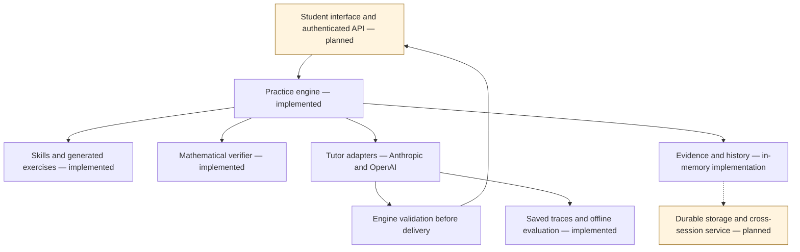
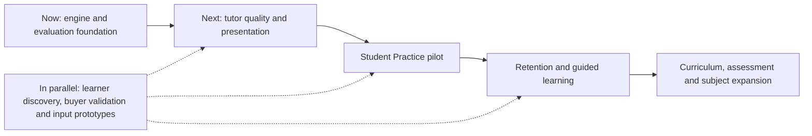

# LearnAI Cofounder Brief

**Vision, current capabilities and the path to a student pilot**

**Snapshot: 1 November 2026.** Current development workspace, including work awaiting integration. This is a founder onboarding brief and roadmap discussion starter, not a release announcement or a finalized MVP requirements contract.

## The idea in one minute

LearnAI is a learning platform designed to help students understand, practise and retain what they learn. Its long-term audience spans primary school through high school and early university, across multiple subjects. The first working foundation is much narrower: a mathematics Practice engine covering a quadratics skill cluster.

The central product bet is that helpful AI explanations become more valuable when paired with evidence of what the student can subsequently do independently. The platform should make those two experiences work together: get help when stuck, then demonstrate understanding through appropriate unaided work.

Today, a substantial engine and evaluation foundation exists. The next major milestone is a usable, persistent student experience around it. LearnAI is **not yet a deployed student-facing MVP**, and the learning benefit and commercial opportunity still need validation with real learners and buyers.

## The problem and the product promise

The motivating concern is the gap between understanding an explanation while reading it and being able to solve a fresh problem later. A student can receive a polished solution, feel progress and still struggle when help is removed. LearnAI aims to make that gap visible and help the student close it.

The product promise is: **receive useful support, know what you can do independently, and return to the right material before it is forgotten.**

Three principles shape the experience:

- **Help should advance understanding.** Respond to the actual question, recognise valid alternative methods and offer a concrete way forward. More hints or more text are not automatically better.
- **Assisted success and independent competence are different signals.** Asking for help should remain normal and welcoming; the progress model should retain how the work was completed.
- **Progress should continue beyond one exercise.** Skills, prerequisites and later retrieval connect individual interactions into a learning path.

The intended experience is a focused learning activity with a tutor alongside it. Replacing teachers, offering unrestricted chat and expanding to every subject before validating one useful experience are outside the initial scope.

## Who we are building for

The long-term learner audience is broad. The current quadratics content is suitable for exploring a narrower secondary-school mathematics starting point; it does not constitute a primary-to-university curriculum.

The initial learner segment, country, curriculum, language and buyer still need a joint decision. Students, parents, schools and tutoring organisations imply different onboarding, purchasing and distribution requirements. These are product and business choices, not settled consequences of the engine design.

For the first pilot, a practical hypothesis is a bounded group of students already studying quadratics, with a clear near-term goal. That keeps content and usability evaluation manageable. Whether this is the best commercial entry point remains open.

## What a student experience should feel like

Consider a student who can follow a worked example but struggles to solve a similar equation alone:

1. They start a focused practice session at a suitable skill and difficulty.
2. They enter an answer and, when useful, partial working. They can ask about one step without submitting the whole answer for grading.
3. The system checks supported mathematics and gives the tutor the exercise, current working, question and relevant session history.
4. The tutor addresses the specific difficulty. It can explain a method, clarify an ambiguous question or show a smaller step, while leaving meaningful work for the student.
5. The system records what happened, including assistance, so finishing the exercise is not confused with independent success.
6. In the planned retention experience, later fresh problems check whether the learning lasts and influence what comes next.

Steps 1–5 have engine support, with limits described below. The student-facing interface and the complete later-review experience remain to be built.

## Product modes and current scope

| Mode | Purpose | Current status |
| --- | --- | --- |
| Practice | Attempt problems, ask focused questions and receive adaptive support | Implemented engine path; no product UI yet |
| Review | Retrieve previously learned material through scheduled checks | Memory/freshness foundations exist; review queue, mode and cards remain planned |
| Learn | Introduce concepts with explanations and progressively faded worked examples | Planned |
| Test or mock exam | Work independently under assessment conditions, then receive a diagnostic report | General policy concepts exist; complete assessment experience remains planned |

The platform is designed for different help permissions and evidence rules across modes. Having those abstractions in code does not mean all four modes are usable today.

## What has been built

“Implemented” below refers to the current development workspace, not a production service.

| Capability | What exists | Why it matters |
| --- | --- | --- |
| Skill and prerequisite graph | Twelve quadratics skills spanning expansion, factoring, solving, completing the square, discriminants, vertex form and an area problem | Supports prerequisite-aware progression rather than a flat exercise list |
| Exercise generation | Twelve deterministic generator templates, with validated answer keys and generator contract tests | Creates fresh variants and reproducible exercises |
| Mathematical verification | SymPy-based answer checking, form constraints, supported step comparisons and misconception matching | Grounds feedback in checks instead of relying entirely on model arithmetic |
| Contextual working checks | Coefficient definitions, supported calculation chains and partial factor branches, with explicit scope notes | Avoids treating valid intermediate working as a wrong transformation |
| Practice orchestration | Session planning, adaptive difficulty, answer submissions, draft questions, help permissions and controlled reveal policy | Gives tutoring a consistent activity structure |
| Evidence and mastery | Assistance-aware evidence classification, strength/stability models, freshness and replayable state projections | Separates help received from evidence of independent performance |
| Conversational context | Revision-bound working and checks, delivered-message history, bounded context selection and scoped current-session history retrieval | Lets the tutor respond to the current situation without treating old work as current |
| AI adapters | Anthropic and OpenAI behind common interfaces, with configurable tutor and evaluator selection | Allows provider/model experiments without moving educational policy into one vendor adapter |
| Runtime controls | Request budgets, tool limits, private repairs, validation before delivery and request traces | Makes failures inspectable and gives interactions operational limits |
| Evaluation tooling | Keyless regression scenarios, live runs, saved-response rejudging, manifests, usage tracking and human calibration workflows | Supports measured iteration rather than judging quality from isolated impressive replies |

Important boundaries: mathematical checking supports defined forms, not arbitrary proofs or every student notation. History retrieval currently covers the current session; durable cross-session access remains ahead. Evidence storage is in memory, even though the event and replay contracts exist. Spaced-review scheduling is not implemented merely because freshness can be calculated.

## How the system fits together

The governing architecture is **the engine decides; the model explains**. Ordinary code owns permissions, evidence and progress updates. The language model can offer a response or proposal, but has no direct tool for editing mastery.

The implemented stack is Python 3.12+, SymPy, YAML-authored content, provider SDK adapters, pytest and Hypothesis. The broader architecture proposes FastAPI, PostgreSQL, SQLAlchemy/Alembic and a React/TypeScript front end; those product-service components are not implemented here. The mathematics input experience still needs prototyping with students.

Subject expansion uses interfaces for verification and content rather than mathematics-specific rules throughout the core. That makes expansion feasible as a design direction, but each subject still needs content, appropriate assessment and its own quality evidence. The architecture has not yet been proven through a second subject implementation.

## What the latest evaluation tells us

The latest recorded full keyless suite passed **1,869 tests**, with four live probes deselected. This is software verification evidence, not a measurement of learning gains.

A fresh fourteen-scenario live tutor batch produced **13 accepted replies and one delivery failure**. Median latency among accepted replies was **2.7 seconds**. These are small-batch observations, not production latency guarantees. All thirteen delivered replies subsequently received user-confirmed ratings through assistant-facilitated discussion; the automated judge comparison is still pending.

The review surfaced useful priorities:

- Several replies handled alternative methods, conceptual questions and incomplete answers well.
- One reply assumed which negative sign the student meant instead of clarifying it.
- One accepted reply incorrectly endorsed subtracting 2 when adding 2 was the useful step. Passing the delivery gate does not guarantee sound mathematical advice.
- Some replies were unnecessarily procedural, dense or generous with solution steps.
- One case repeatedly produced terminal escape characters and exhausted its repair limit; the guard prevented delivery.

These observations support continued quality work. They do not establish classroom effectiveness, retention improvement, willingness to pay or reliable production performance. OpenAI usage is recorded, but monetary cost accounting still lacks an applicable price snapshot.

## The next presentation improvement

A design draft proposes replacing the tutor’s single message string with typed paragraphs, lists and inline/displayed mathematical notation. The front end would control visual layout, while the engine would inspect the same content that the student sees.

The intended extension boundary allows subjects and topics to select reusable content types. A future chemistry reaction or history timeline would not require building subject-specific branches into every part of the engine. The first version is limited to text, lists and equations; interactive elements come later.

This is **a reviewed design draft awaiting approval and implementation**, not a shipped capability. It also requires coordinated changes to provider schemas, validation, history, saved artifacts and evaluation. Clear structure should help explanations remain readable without forcing every answer into a list or making it longer.

## Roadmap from the foundation to a pilot

The following sequence combines existing technical plans with proposed pilot-readiness checkpoints. It is a dependency roadmap, not a dated delivery commitment. Business discovery and product testing should run alongside engineering.

| Stage | Main technical work | Evidence needed to move forward |
| --- | --- | --- |
| Finish current quality work | Compare the frozen judge with saved human ratings; investigate observed failures; integrate and verify pending changes | Failures and disagreements remain visible; a reproducible baseline is established |
| Make explanations ready for presentation | Approve and implement the structured-content contract; preserve validation and old history; test readability | The rendered response matches what the engine checks, and explanations remain usable |
| Build the Practice product | Authenticated API, durable database and migrations, cross-session history, task/progress UI, mathematics input, error/recovery flows and deployment | A learner can complete and resume a useful practice session without developer assistance |
| Prepare and run a bounded pilot | Operational monitoring, usage/cost measurement, content review, appropriate account/data handling and a learner recruitment plan | Observed usability, independently completed work, reliability and a credible cost per useful session |
| Add Review | Due-review scheduler, review sessions and retrieval cards using the existing evidence model | Returning students can practise the right material, and delayed performance can be measured |
| Add Learn | Structured teaching content and progressively faded worked examples | New or weak skills can be introduced effectively before independent practice |
| Expand the product | Courses/curriculum mapping, placement and mock exams; then another subject adapter | A validated initial learning experience and evidence that each extension serves a concrete need |

The original long-term sequence uses physics as the first second-subject test, followed later by bring-your-own problems with subsequent practice. Chemistry, history, media, interactive content, photo input and conversational detours are possibilities, not committed first-release features. Parent/teacher dashboards and billing are also outside the implemented product.

## Decisions for the founding team

The most valuable business/product contribution now is to turn a broad vision into a specific first customer and a testable product promise.

| Decision | What needs to become concrete |
| --- | --- |
| Initial learner and learning moment | Which age/course, which difficulty, and when they would reach for LearnAI |
| Buyer and distribution | Who pays, who introduces it, and how the first pilot participants are reached |
| Curriculum and language | Which syllabus, geography and language to support first |
| Experience | How students enter work, understand feedback and distinguish supported practice from independent checks |
| Pilot design | What the learner does, how long they return, and which observations would justify continuing or changing direction |
| Commercial model | Pricing hypothesis, willingness to pay and acceptable support/inference costs |

There is no agreed business model, pricing, market-size estimate or launch date in this brief. Those choices should follow discovery rather than being inferred from technical progress.

The major product risks are understandable: students may find input cumbersome, the tutor may be wrong or overhelpful, the mastery model may not match real learning, content expansion may be expensive, and useful sessions may cost too much to serve. Before use with minors, account design, data handling and the applicable privacy requirements need appropriate review. These are concrete workstreams for the pilot, not reasons to postpone all learner discovery.

## What success should mean

The primary outcome hypothesis is **better independent performance on fresh problems after a delay**. Engagement and satisfaction matter, but neither proves that outcome by itself.

For a first pilot, agree measures in four groups:

- **Learning:** fresh unaided problem success, delayed success and common persistent errors.
- **Experience:** completing a session, difficulty entering mathematics, time to useful help and reasons for abandonment.
- **Reliability:** incorrect feedback, rejected/missing replies, latency distribution and successful session recovery.
- **Business:** repeat use for a real need, buyer feedback, willingness to pay and fully accounted cost per session.

No numerical success thresholds are committed yet. Set them with a pilot population and baseline, and keep operational metrics separate from evidence of learning.

## Suggested first cofounder conversation

Start by agreeing on one learner, one problem and one useful session. Then decide which assumptions to test through interviews or a prototype before expanding the engineering scope. End with a small set of shared decisions: initial segment, pilot learning goal, input experience to prototype, and the evidence that will determine the next investment.

The near-term opportunity is to turn a well-tested tutoring foundation into something learners can use and evaluate. The long-term vision remains a subject-extensible platform connecting explanation, practice, independent assessment and retention.

## Technical reading and evidence

For deeper follow-up in the repository:

- `docs/superpowers/specs/2026-09-14-ai-tutoring-platform-design.md` — broader product vision, policies and original slice sequence. Its initial stack and roadmap descriptions are plans, not current implementation status.
- `src/learnai/domain/` and `content/quadratics/skills.yaml` — current engine and twelve-skill cluster; `contracts.py` and `planner.py` establish the current Practice scope and scheduling boundary.
- `src/learnai/adapters/` and `src/learnai/application/` — verification, in-memory persistence, providers and composition boundaries.
- `docs/superpowers/plans/2026-10-31-contextual-work-verification.md` — latest recorded complete keyless test result and bounded verification improvements.
- `docs/superpowers/notes/2026-10-31-independent-tutor-generation.md` and the private run’s completed human review — live operational evidence and subsequent response ratings. Raw operational artifacts remain private.
- `docs/superpowers/specs/2026-10-31-structured-tutor-content-design.md` — proposed structured content and subject-extension boundaries.
- `eval/README.md` — evaluation workflows, reproducibility and known operational limits.

This dated snapshot includes the current worktree’s uncommitted changes. It should be refreshed after integration or a change in pilot priorities; it is not a claim about what has shipped from the main branch.
